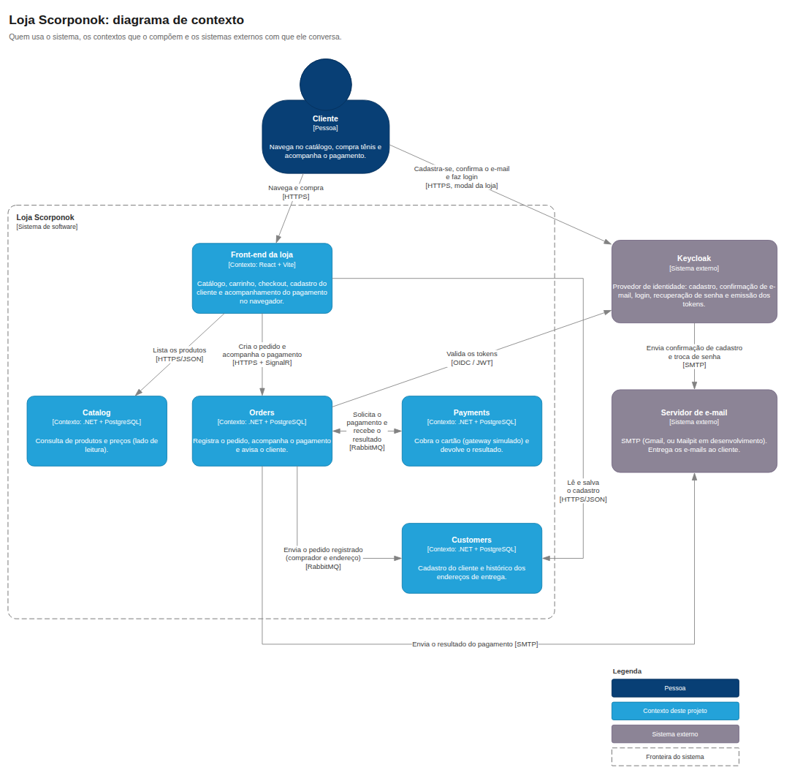
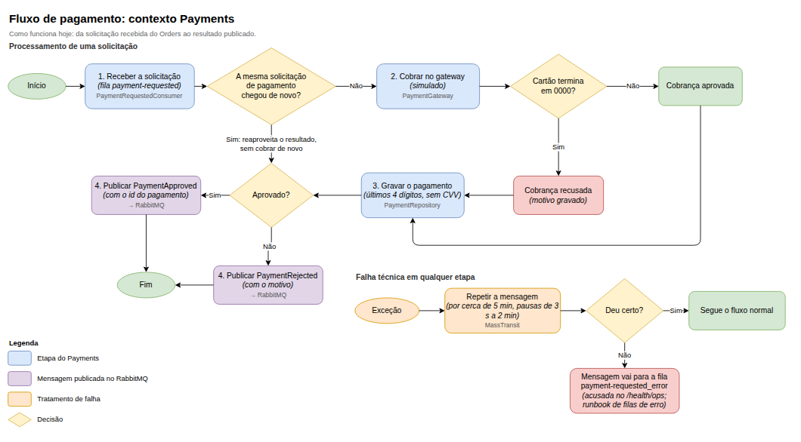

<!-- # Scorponok: um e-commerce modular em .NET

 -->

## O que é o projeto

O Scorponok é um e-commerce de código aberto, escrito em .NET 10 e React, feito para estudo e demonstração. O objetivo é aplicar as tecnologias e os padrões mais usados no mercado e compartilhar com a comunidade uma forma de construir boas aplicações com .NET.

## Diagrama de contexto

Quem usa a loja, os contextos que a compõem e os sistemas externos com que ela conversa.



Fonte editável: [`docs/diagrams/contexto.drawio`](docs/diagrams/contexto.drawio) (abre no draw.io ou no diagrams.net). O fluxo de compra, do catálogo ao resultado do pagamento, está em [`usecases/`](usecases/README.md#fluxo).

## Bounded contexts

O backend fica em `src/backend/` e é dividido em contextos. Cada um é dividido em camadas (domínio, commands ou queries, infraestrutura e Web API) e tem sua API e seu banco.

| Contexto | Responsabilidade |
|---|---|
| **Catalog** | Lado de leitura: lista e detalha os produtos |
| **Orders** | Lado de escrita: registra o pedido do cliente autenticado, acompanha o pagamento e envia o resultado por e-mail e pela loja (SignalR) |
| **Payments** | Recebe a solicitação de pagamento pelo RabbitMQ, decide, grava e devolve o resultado (o gateway é um stub) |
| **Customers** | Cadastro do cliente (nome, telefone, CPF e endereço), criado na primeira compra, e o histórico dos endereços de entrega dos pedidos |
| **Shared / Frameworker** | Blocos de DDD/CQRS, contratos de integração, paginação, tipos funcionais e bases de teste |

O front-end (`src/frontend/`) é a loja: catálogo, carrinho, login e cadastro pelo Keycloak, "Meu cadastro" e checkout.

### Fluxo de um pedido

1. O cliente entra pela loja (Keycloak) e confirma o pedido no checkout, com os dados de quem compra e o endereço de entrega (preenchidos pelo cadastro, se houver).
2. O Orders grava o pedido como `Pending` e, na mesma transação, as mensagens `PaymentRequested` e `OrderPlaced` (outbox). A resposta não depende do broker. O Customers consome o `OrderPlaced`: guarda o endereço no histórico e, na primeira compra, cria o cadastro.
3. O Payments consome a mensagem, cobra no gateway e publica `PaymentApproved` ou `PaymentRejected`.
4. O Orders passa o pedido para `Confirmed` ou `Failed`, avisa a loja pelo SignalR e envia o resultado por e-mail.

O passo 3, dentro do contexto Payments:



Fonte editável: [`docs/diagrams/fluxo-pagamento.drawio`](docs/diagrams/fluxo-pagamento.drawio). As melhorias propostas para as falhas nesse fluxo estão em [`docs/solucoes-tecnicas/`](docs/solucoes-tecnicas/README.md).

## Tecnologias

**Backend**
- .NET 10, ASP.NET Core Minimal APIs e Swagger (Swashbuckle)
- Entity Framework Core 10 com PostgreSQL 16 (Npgsql)
- MediatR 13 e FluentValidation
- MassTransit 8 sobre RabbitMQ 4, com outbox transacional
- SignalR para avisar a loja do resultado do pagamento
- MailKit para e-mail (Mailpit em desenvolvimento)
- Keycloak 26 (OpenID Connect, JWT Bearer)

**Front-end**
- React 19, TypeScript, Vite e React Router 7
- Tailwind CSS 4, shadcn/ui e Radix UI
- `oidc-client-ts` (Authorization Code + PKCE)

**Testes**
- NUnit, FluentAssertions e Moq
- SpecFlow (cenários BDD)
- `WebApplicationFactory` e Testcontainers
- Test harness do MassTransit

**Infraestrutura**
- Docker Compose: uma API e um Postgres por contexto, mais RabbitMQ, Mailpit, Keycloak e o front-end
- GitHub Actions: build e testes a cada push e pull request no `master`

## Arquitetura e padrões

- Separação de responsabilidades, SOLID e Clean Code
- Domain-Driven Design (agregados, value objects, bounded contexts)
- CQRS com MediatR
- Domain Notifications
- Integration events entre contextos, com outbox
- Repository genérico e Unit of Work
- Health checks de liveness e readiness

## Pré-requisitos

- Docker com Docker Compose
- .NET SDK 10.0 (https://dot.net), para rodar as APIs e os testes fora do Docker
- Node.js 24, só para rodar o front-end fora do Docker

## Como rodar

### Tudo no Docker

```bash
docker compose up -d --build
```

Isso sobe as quatro APIs, os bancos, o RabbitMQ, o Mailpit, o Keycloak e a loja. Na primeira vez, o Keycloak leva alguns segundos para importar o realm.

| Serviço | Endereço |
|---|---|
| Loja | http://localhost:3000 |
| Catalog API (Swagger) | http://localhost:5064/swagger |
| Orders API (Swagger) | http://localhost:5224/swagger |
| Payments API (Swagger) | http://localhost:5220/swagger |
| Customers API (Swagger) | http://localhost:5230/swagger |
| Keycloak (console: `admin`/`admin`) | http://localhost:8080 |
| Mailpit (caixa de entrada de desenvolvimento) | http://localhost:8025 |
| RabbitMQ (painel: `guest`/`guest`) | http://localhost:15672 |

Para comprar, crie uma conta na loja. O link de confirmação chega no Mailpit; depois de abri-lo, defina a senha.

### APIs com `dotnet run`

Suba a infraestrutura com o Docker e rode as APIs localmente:

```bash
docker compose -f docker-compose.database.yml up -d     # bancos
docker compose -f docker-compose.messaging.yml up -d    # RabbitMQ
docker compose -f docker-compose.mail.yml up -d         # Mailpit
docker compose -f docker-compose.identity.yml up -d     # Keycloak

dotnet run --project src/backend/Catalog/Catalog.Web.Api
dotnet run --project src/backend/Store/Orders.Web.Api
dotnet run --project src/backend/Payments/Payments.Web.Api
dotnet run --project src/backend/Customers/Customers.Web.Api
```

O front-end tem as instruções próprias em `src/frontend/` (`npm install` e `npm run dev`).

Cada `*.Web.Api` tem um arquivo `.http` para testar os endpoints.

### Build e testes

```bash
dotnet build Scorponok.slnx
dotnet test Scorponok.slnx
```

## Enviar e-mail de verdade

Por padrão, todos os e-mails vão para o Mailpit, que não entrega nada para fora. Para enviar por um SMTP real (por exemplo, o Gmail com uma senha de app), crie um `.env` na raiz, que o git ignora:

```env
SMTP_HOST=smtp.gmail.com
SMTP_PORT=587
SMTP_FROM=seu.email@gmail.com
SMTP_USERNAME=seu.email@gmail.com
SMTP_PASSWORD=<senha de app>
SMTP_USE_STARTTLS=true
```

O mesmo `.env` vale para os e-mails de pedido (Orders) e para os do Keycloak (confirmação de cadastro e troca de senha). O Keycloak só lê esses valores quando importa o realm. Se ele já estiver no ar, recrie o volume `keycloak_data` (isso apaga as contas) ou ajuste em *Realm settings* → *Email* no console.

Nunca coloque senhas em arquivos versionados.

## Health checks

Cada API tem dois endpoints que informam se ela está funcionando:

- `/health/live`: a API está no ar. Se falhar, reinicie a API. Ele não verifica nenhuma dependência, para que uma queda do banco não faça as APIs reiniciarem.
- `/health/ready`: a API consegue atender pedidos. Se falhar, espere ela se recuperar.

| API | Porta | O que o `/health/ready` verifica |
|---|---|---|
| Catalog | 5064 | Banco de produtos |
| Orders | 5224 | Banco de pedidos |
| Payments | 5220 | Banco de pagamentos e RabbitMQ |
| Customers | 5230 | Banco de cadastros |

O Orders tem também o `/health/bus`, que verifica o RabbitMQ. Ele fica fora do `/health/ready` porque o registro de pedidos não depende do broker: com o RabbitMQ fora, o pedido é aceito e a solicitação de pagamento sai quando ele volta. O Customers tem o mesmo `/health/bus`, fora do `/health/ready`: o cadastro funciona sem o broker.
