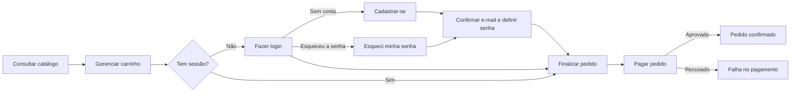

# Casos de uso

Descrevem o que a loja faz hoje, do ponto de vista de quem a usa. As regras detalhadas, com cenários, ficam nas specs do OpenSpec (`openspec/specs/`).

## Compra

| ID | Caso de uso | Ator |
|---|---|---|
| [UC01](UC01-consultar-catalogo.md) | Consultar catálogo | Visitante |
| [UC02](UC02-gerenciar-carrinho.md) | Gerenciar carrinho | Visitante |
| [UC03](UC03-finalizar-pedido.md) | Finalizar pedido | Cliente |
| [UC04](UC04-pagar-pedido.md) | Pagar pedido | Cliente, serviço de pagamentos |

## Conta do cliente

| ID | Caso de uso | Ator |
|---|---|---|
| [Login-UC05](Login-UC05-cadastrar-se.md) | Cadastrar-se | Visitante |
| [Login-UC06](Login-UC06-confirmar-email.md) | Confirmar e-mail e definir senha | Visitante |
| [Login-UC07](Login-UC07-fazer-login.md) | Fazer login | Visitante |
| [Login-UC08](Login-UC08-esqueci-minha-senha.md) | Esqueci minha senha | Visitante |
| [Login-UC09](Login-UC09-sair.md) | Sair | Cliente |

**Visitante** é quem navega sem sessão; **cliente** é quem entrou com uma conta de e-mail confirmado. O cadastro, o login e a senha ficam no Keycloak, que a loja abre num modal sem sair da página.

## Fluxo

## Situação do pedido

| Situação | Quando ocorre |
|---|---|
| Pendente | Pedido registrado, aguardando o resultado do pagamento |
| Confirmado | Pagamento aprovado |
| Falha no pagamento | Pagamento recusado |

O domínio também define outras situações (Em processamento, Enviado, Entregue, Cancelado, Devolvido, Reembolsado etc.), mas nenhum fluxo as usa hoje.

## Fora do escopo hoje

Itens que aparecem na loja sem comportamento de verdade, ou que ainda não existem:

- **Busca** no cabeçalho: o campo existe, mas não pesquisa.
- **Lista de desejos** ("Adicionar aos favoritos"): só alterna o ícone; nada é guardado.
- **Contato:** o formulário simula o envio; nenhuma mensagem é entregue.
- **Histórico de pedidos:** o cliente não consulta os pedidos anteriores; o resultado chega na tela do checkout e por e-mail.
- **Cancelamento, devolução e reembolso.**
- **Estoque, frete, impostos e descontos.**
- **Pagamento real:** o serviço de pagamentos é simulado (veja o UC04).
